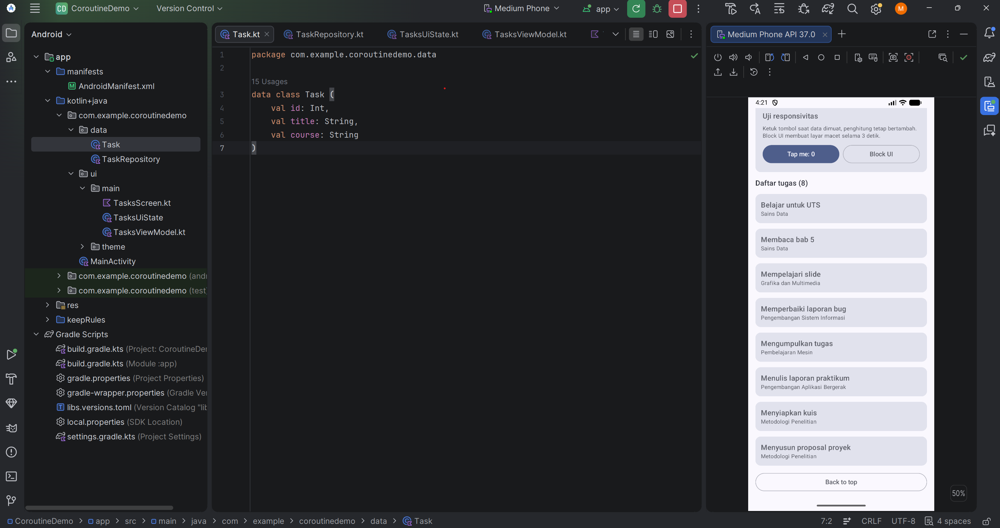

# CoroutineDemo

Aplikasi Android (Jetpack Compose + MVVM) untuk mempraktikkan **Kotlin Coroutines dan Asynchronous Programming** (Modul 17, Pengembangan Aplikasi Bergerak). Proyek ini melanjutkan aplikasi dari modul dan mengerjakan Latihan (Bagian 9).

## Fitur

| Tombol | Fungsi | Konsep |
|---|---|---|
| Load | Memuat daftar tugas (2 dtk), pengumuman (1 dtk), dan jumlah mata kuliah (1,5 dtk) secara bersamaan | launch, async, withContext |
| Load (fail) | Simulasi server gagal, tampil pesan error | try/catch, structured concurrency |
| Cancel | Menghentikan proses pemuatan | Job.cancel() |
| Retry | Muncul di samping pesan error, memuat ulang data | UI state + event |
| Sort | Mengurutkan tugas berdasarkan judul di `Dispatchers.Default` | withContext |
| Tap me | Penghitung untuk membuktikan layar tetap lancar | suspend tidak menghambat thread |
| Block UI | `Thread.sleep(3000)` di main thread (contoh buruk) | Main thread terhambat |

## Struktur

```
com.example.coroutinedemo
├── data
│   ├── Task.kt
│   └── TaskRepository.kt
├── ui
│   ├── main
│   │   ├── TasksUiState.kt
│   │   ├── TasksViewModel.kt
│   │   └── TasksScreen.kt
│   └── theme
└── MainActivity.kt
```

## Jawaban Latihan

### Latihan 1: Tambah satu permintaan lagi

`getCourseCount()` ditambahkan di `TaskRepository` dengan `delay(1500L)`, hasilnya disimpan di field `courseCount` pada `TasksUiState`, dan dimuat lewat `async` ketiga di `loadData()`.

**Apakah total waktu pemuatan masih sekitar 2 detik?** Ya. Ketiga `async` berjalan bersamaan (konkuren), sehingga total waktunya sama dengan pekerjaan yang paling lama, yaitu `max(2000, 1000, 1500) = 2000 ms`. Kalau dipanggil satu per satu, totalnya adalah jumlahnya, yaitu 4,5 detik.

### Latihan 2: Tombol Retry

Tombol **Retry** ditampilkan di sebelah pesan error dan hanya muncul kalau `errorMessage != null`. Tombol ini memanggil `loadData()` lagi.

### Latihan 3: Menangkap terlalu banyak

`catch (e: IOException)` diganti `catch (e: Exception)`, lalu Load dan segera Cancel.

**Pesan yang muncul:** `Gagal memuat: <isi sesuai pesan yang tampil di layar>`, bukan lagi `Pemuatan dibatalkan`.

**Kenapa berbeda:** `cancelLoading()` memang menampilkan "Pemuatan dibatalkan", tetapi setelah itu coroutine yang dibatalkan melempar `CancellationException` di titik suspensi (`await()` / `delay()`). `CancellationException` adalah turunan `Exception`, jadi ikut tertangkap oleh `catch (e: Exception)` dan dianggap sebagai kegagalan. Blok catch lalu menimpa pesan menjadi "Gagal memuat: ...". Pembatalan yang seharusnya normal jadi terbaca sebagai error. Karena itu sebaiknya menangkap exception yang spesifik (IOException), atau kalau terpaksa menangkap `Exception`, lempar ulang `CancellationException` lebih dulu.

### Latihan 4: Di mana macetnya?

1. **`Thread.sleep(2000L)` di dalam `withContext(Dispatchers.IO)`:** layar **tidak macet**. Tombol Tap me tetap bereaksi dan indikator putar tetap berputar. Yang tertahan hanya thread IO, bukan main thread.
2. **`withContext` dihapus:** layar **macet** selama sekitar 2 detik. Tap me tidak bereaksi dan indikator putar berhenti.

**Penjelasan:** `viewModelScope` memakai `Dispatchers.Main` secara bawaan. Tanpa `withContext(Dispatchers.IO)`, `getTasks()` berjalan di main thread, dan `Thread.sleep()` menahan seluruh thread, bukan hanya coroutine seperti `delay()`. Main thread yang tertahan tidak bisa menggambar frame atau memproses sentuhan. Kalau berlangsung sekitar 5 detik, Android menampilkan dialog ANR. Karena itu kelas yang mengerjakan pekerjaan berat (repository) bertanggung jawab memindahkannya ke dispatcher yang tepat, sehingga fungsinya *main-safe*.

### Latihan 5: Pertanyaan konsep

**(a) Beda `launch` dan `async`:** `launch` menghasilkan `Job` dan tidak mengembalikan nilai, cocok untuk pekerjaan yang cukup "dijalankan saja" seperti menyimpan data atau memperbarui state. `async` menghasilkan `Deferred<T>`, yaitu janji bahwa nilai akan tersedia nanti, dan hasilnya diambil dengan `await()`. `async` cocok untuk beberapa pekerjaan independen yang hasilnya dibutuhkan dan ingin dijalankan bersamaan.

**(b) Kenapa `GlobalScope` dihindari:** `GlobalScope` tidak terikat lifecycle apa pun dan hidup selama aplikasi berjalan. Coroutine di dalamnya tidak ikut berhenti ketika layar ditutup atau ViewModel dihapus, sehingga pekerjaan bisa bocor (memory leak, boros baterai dan data, atau mencoba memperbarui UI yang sudah tidak ada). Selain itu coroutine tidak punya parent sehingga keluar dari aturan structured concurrency. Gunakan `viewModelScope`, `lifecycleScope`, atau scope bawaan Compose.

**(c) Nasib `getAnnouncement()` kalau `getTasks()` gagal:** keduanya child dari `coroutineScope`. Ketika `getTasks()` gagal dan melempar `IOException`, scope membatalkan semua sibling-nya, sehingga `getAnnouncement()` dihentikan di tengah `delay()` dan tidak pernah selesai. Setelah itu `coroutineScope` meneruskan `IOException` ke pemanggil, ditangkap `try/catch` di ViewModel, lalu diubah menjadi `errorMessage`.

### Latihan 6: Tombol Sort (tantangan)

`TaskRepository.sortTasks()` memakai `withContext(Dispatchers.Default)` karena pengurutan adalah pekerjaan CPU (bukan I/O). ViewModel memanggilnya di `viewModelScope`, lalu memperbarui state dengan hasil yang sudah terurut. Tombol Sort dinonaktifkan saat loading atau saat daftar kosong.

## Modifikasi dan Pengembangan

Semua modifikasi memakai materi dari modul, tanpa library atau konsep tambahan.

| Modifikasi | Materi modul |
|---|---|
| Switch mode pemuatan: **concurrent** (tiga `async` bersamaan, sekitar 2000 ms) atau **sequential** (dipanggil satu per satu, sekitar 4500 ms) | Bagian 3.7, 5.2 |
| Lama pemuatan diukur dengan `measureTimeMillis` dan ditampilkan di kartu status | Bagian 3.7 |
| Petunjuk (tip) yang hilang otomatis setelah 3 detik | `LaunchedEffect`, Bagian 4.3 |
| Tombol **Back to top** untuk menggulir daftar ke atas | `rememberCoroutineScope`, Bagian 4.3 |
| Tampilan baru: satu `LazyColumn` dengan kartu mode, kartu status (loading, error dengan Retry, hasil), dan kartu uji responsivitas | Bagian 7.8 (state hoisting) |
| Data tugas ditambah menjadi 8 dan jumlah mata kuliah menjadi 6 supaya daftar bisa digulir | Bagian 7.5 |
| Teks tampilan, pesan error, dan data contoh diubah ke bahasa Indonesia (nama tombol dan judul tetap bahasa Inggris) | Bagian 7.5 sampai 7.8 |

## Tangkapan Layar

<!-- Tambahkan screenshot di folder screenshots/ lalu tautkan di sini -->

### 1. Aplikasi sesuai modul (sebelum modifikasi)

| Kondisi | Screenshot |
|---|---|
| Setelah Load (3 tugas dan pengumuman) | .png>) |

### 2. Aplikasi setelah modifikasi

| Kondisi | Screenshot |
|---|---|
| Setelah Load, mode konkuren (sekitar 2000 ms) | .png>) |
| Setelah Load, mode sekuensial (sekitar 4500 ms) | .png>) |
| Load (fail) dengan tombol Retry (1) |  + Retry (1).png>) |
| Load (fail) dengan tombol Retry (2) |  + Retry (2).png>) |
| Setelah Sort by title |  |
